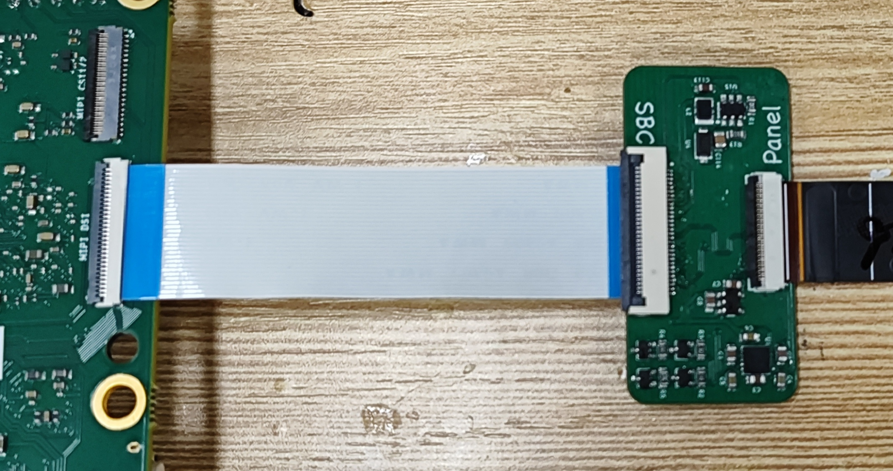

# TL060FVXS07 For DshanPi-A1

## 内含文件  

- 转接板的LCEDA工程文档
- 适用于Armbian的设备树Overlay源码

## 食用说明

- 触摸驱动可以直接用[radxa的](../瑞莎/rock4d/sec_ts/)，按照它的说明构建。
> 你也可以写一个Makefile放到板子上构建module然后直接安装，
> 无需编译内核，但需要安装kernel headers，
> 见[DshanPi Wiki](https://wiki.dshanpi.org/docs/DshanPi-A1/LDDBasic/05-7_TuYa_ws2812#11-%E4%B8%8B%E8%BD%BD%E5%86%85%E6%A0%B8%E5%A4%B4%E6%96%87%E4%BB%B6)。

- 设备树源码可以合并到到开发板的设备树源码里构建（参考其他开发板的用法），或者直接用armbian的overlay工具加载：
``` bash
sudo armbian-add-overlay tl060fvxs07.dts
```

- 排线可以用同向或反向的，但是要确保转接板的正面朝开发板背面，如图：



- 背光驱动电压最高可达约23V，确保选用耐压足够（建议50V）的电容作为背光供电输出电容。
  

